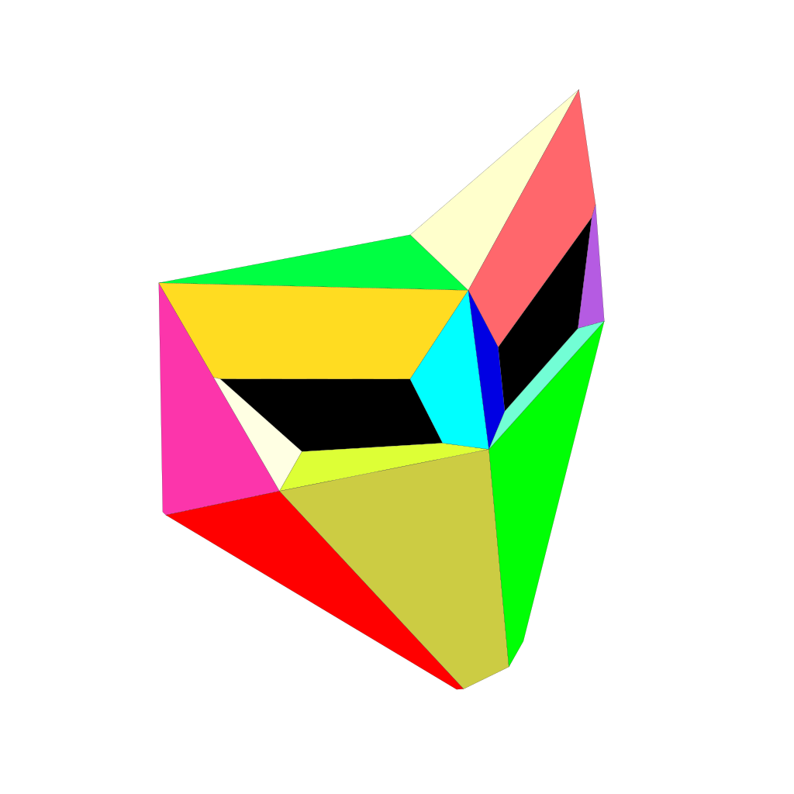

# Deception

**Bluff armies. Steal information. Turn your opponent’s units into liabilities.**

Deception adds a new technology branch to **The Battle of Polytopia**, built around disguises, espionage and information warfare. A frightening army might be a handful of fragile Mimics. An enemy unit might be working for you. Even explored territory can disappear behind fog again.

<p align="center">
  
  
</p>

## What it adds

### Mimics and disguises

Recruit **1-star Mimics** with just **1 HP** and no damaging attacks. Use **Regroup** to copy a nearby unit’s appearance, with the option to swap positions. Mimics inherit their disguise’s movement through **Mimicry**—but looking powerful does not make them powerful.

Research **Propaganda** to unlock **Disinformation**, allowing otherwise eligible appearances without their technology, and **Disguise**, which transfers an appearance to an allied unit. Ordinary disguised units retain their real movement capabilities; an incompatible move sheds the disguise. You can also shed it deliberately.

Mimics can **Smuggle** resources for their home city and imitate the presentation of support effects through feints. Aquarion gets the amphibious **Mermimic**.

### Spies and Blackmail

**Spies** use **Subvert** to temporarily command an enemy unit as a Rogue. They have 2 movement, but no Dash or innate invisibility: choose whether to move or act. Aquarion recruits **Spymaids**.

**Blackmail** a visible enemy unit for **2 stars**. Each application redirects **1 star per turn** from its supporting city to you. Apply it again on later turns to increase the pressure, up to the city’s available income. The opponent must decide whether keeping that unit is worth the cost.

Blackmail persists when the unit enters fog without revealing its location. Losing or converting the unit, changing its supporting city’s owner, or making peace ends the effect.

### Reconnaissance and Surveillance

**Reconnaissance** marks technologies known to opponents you have met on your technology tree. **Surveillance** lets you toggle a view of an opponent’s fog, using a translucent tribe-coloured overlay.

### Foggers and Trade Secrets

**Foggers** are flying support units with Dash, Scout and **Blackout**. Move into position, then throw up to two smoke grenades to cover tiles with fog again. They cannot deal damage.

**Trade Secrets** earns **1 / 2 / 3 stars per turn** for each tier 1 / 2 / 3 technology a met opponent owns that you do not. Income stacks across met opponents.

## Technology branch

```text
Deception — Mimics
├── Propaganda — Disinformation + Disguise
│   └── Espionage — Spies + Blackmail
└── Intelligence — Reconnaissance + Surveillance
    └── Counter Intelligence — Foggers + Trade Secrets
```

## Status and compatibility

**Experimental; being prepared for PolyMod developer review.** The descriptions above explain the intended gameplay. They are not a claim that every interaction or platform is fully validated.

| Component | Current evidence |
| --- | --- |
| Polytopia | Pinned to game build **2.17.3.16375** |
| Public PolyMod **1.2.18** | Local startup observed; user reported basic testing on an earlier review candidate |
| Supplied multiplayer beta **1.3.0-pre-android-multi-1** | Unmodified DLL tested locally on Mac; narrow runtime compatibility shim remains in Deception |
| macOS | Local gameplay testing on the existing Intel/Rosetta compatibility stack |
| Windows | Earlier experimental build had user-reported basic gameplay; the current clean-loader candidate is not validated on Windows |
| Linux | Helper tooling exists; full game integration is unverified |
| Multiplayer | Matching supported builds required; current two-client/cross-platform acceptance is still pending |

Intermittent black-screen startup remains under investigation. Automated model and adapter tests do not establish native gameplay or multiplayer correctness.

## Installation and downloads

There is **no approved general-purpose review release yet**. The former loader-containing setup ZIPs were withdrawn. Do not use historical bundled-setup instructions as the current installation guide.

You need your own copy of Polytopia and PolyMod obtained from its developers. This repository does not grant redistribution rights to their game, loader or runtime components. A source checkout alone is not a complete installation.

- [Official-loader review workflow and exact compatibility details](docs/PUBLIC-POLYMOD-REVIEW.md)
- [PolyMod public releases](https://github.com/PolyModdingTeam/PolyMod/releases)
- [Windows development notes](docs/WINDOWS-PORT.md) — experimental and version-specific
- [Shared-build workflow](docs/SHARED-BUILD-FROM-MAC.md) — developer tooling, not a supported end-user installer

When a reviewed `.polymod` is published, its release notes will identify the supported game, loader and platform combination. Do not assume an old test archive is compatible with a newer build.

## Feedback

Bug reports and balance feedback are welcome. Include:

- Game, PolyMod and Deception versions; operating system.
- What you did, what you expected, and what happened.
- Whether it was single-player, pass-and-play or online.
- A screenshot or short recording when useful.

Share only the relevant log excerpt after checking it for personal information. Do not post credentials, private match data or full diagnostic archives publicly.

## Development and technical review

Deception is a compiled C# PolyMod mod with custom art/audio, model tests and platform-specific native helpers. Those helpers currently handle parts of command execution and persistent game state. The clean beta DLL is not modified on disk; an exact-version runtime filter handles one incompatible serializer registration.

We are investigating supported PolyMod/Polibrary APIs to reduce that custom integration. See the [helper-library audit](docs/HELPER-LIBRARY-AUDIT.md) for concrete alternatives and remaining gaps.

- [Contributing and build workflow](CONTRIBUTING.md)
- `project/src/` — gameplay, adapters and native helper source
- `project/content/` — mod definitions, localization and assets
- `project/tests/` — model, adapter and native-boundary tests
- `project/spec/` — design decisions and amendments
- `project/tools/` — guarded build and installation tooling
- `distribution/` — setup tooling and platform notes; historical instructions may be superseded

## Credits and rights

Mod design, supplied artwork and audio: **Alex**. Implementation developed with AI assistance.

The Battle of Polytopia belongs to its respective rights holders. PolyMod and other dependencies belong to their authors. Deception is an unofficial community project, not an official Midjiwan or PolyMod release.

No blanket open-source license has been selected for this repository. Public visibility alone does not grant permission to redistribute third-party material. See [publication notes](PUBLICATION.md) for omitted native catalogs, local build requirements and asset provenance.
